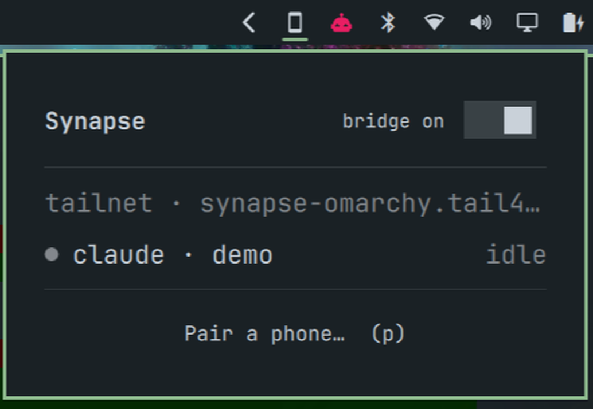

# Synapse

Drive your terminal AI agents — **Claude Code, Codex, Kimi, Grok**, or anything with a TUI — from an Android phone.
An [Omarchy](https://omarchy.org) bar widget shows the sessions that need you; the Android app is a live terminal with
one-tap answers on the notification. Works at home, over USB, or anywhere through your own Tailscale node.



```
 Omarchy desktop                                        Android
┌─────────────────────────────────┐  TLS 1.3 + SSE  ┌──────────────────┐
│ tmux session "synapse-foo"      │◀───────────────▶│  Synapse app     │
│   └─ claude / codex / ...       │  pinned cert +  │  sessions list   │
│ synapse serve (bridge)          │  bearer token   │  live screen     │
│ Quickshell bar widget (plugin)  │                 │  keys + input    │
└─────────────────────────────────┘                 │  notifications   │
                                                    └──────────────────┘
```

Agents run inside **tmux**. The bridge captures the pane and types keys into it, so no per-agent integration is needed,
and you can keep working in the same session from your terminal (`synapse attach`, or `synapse run` attaches for you).

## What is in this repository

This repository **is** the Omarchy plugin (`manifest.json` and `Panel.qml` in the root) and also holds the backend it
talks to and the Android app.

| Path | What |
|---|---|
| `manifest.json`, `Panel.qml` | The Omarchy bar widget: sessions, "needs you" badge, pairing QR, bridge on/off, tailnet state. |
| `bridge/synapse.py` | Bridge server + `synapse` CLI. Python standard library only. |
| `systemd/` | User units: `synapse.service` (bridge) and `synapse-net.service` (tailnet node, sandboxed). |
| `tailnet/` | Go: embedded tailnet node. `cmd/synapse-net` (desktop sidecar), `jni` (Android library), `node` (shared). |
| `android/` | Kotlin + Jetpack Compose app (build it yourself, see below). |
| `install.sh` | Installs / removes the backend. Asks before it does anything. |

## Requirements

* **Omarchy** with the Quattro shell (for the widget). The backend also runs on any Linux with systemd (user units).
* `tmux`, `python3` (3.9+), `openssl`. Optional: `qrencode` (QR in the terminal and in the widget).
* Optional, for the tailnet node: **Go** (to build one static binary; `mise exec go@latest` is enough) and a Tailscale account.
* An **Android 10+** phone (arm64) for the app: install the signed APK from the Releases page, or build it yourself
  (`android/`, JDK 17+ and the Android SDK; the tailnet library also needs Go and the NDK, see `tailnet/build-android.sh`).

## Installation

The widget and the backend are installed in two explicit steps; nothing runs until you say so.

**1. The widget (from the Omarchy marketplace or git):**

```bash
omarchy plugin add https://github.com/Lwb89dev/synapse.git --enable
```

This only copies this repository to `~/.config/omarchy/plugins/io.github.lwb89dev.synapse/`. Until the backend exists
the widget says so and offers a **Set up…** button.

**2. The backend** — press **Set up…** in the widget, or run the installer yourself:

```bash
~/.config/omarchy/plugins/io.github.lwb89dev.synapse/install.sh
```

It prints exactly what it will do and asks for confirmation: it links the `synapse` command into `~/.local/bin`,
installs the user units in `~/.config/systemd/user/` and starts them, and (if Go is available) builds the tailnet
node. **No sudo, nothing outside `$HOME`, no edit to your Omarchy or Hyprland configuration** (the bar entry is added by
`omarchy plugin enable`, i.e. by you).

*From a development checkout:* `./install.sh --enable` does the same and links the checkout as the plugin.

**3. The phone app** — download `synapse-<version>.apk` from the
[Releases](https://github.com/Lwb89dev/synapse/releases) page and install it (allow installs from your browser/files
app). It is signed with the project key: check
`apksigner verify --print-certs` shows certificate SHA-256 `A9:97:92:9A:…:33:89:8E` (full value and file checksum are in
the release notes). Then run `synapse pair` and scan the QR. Changes per version: [CHANGELOG.md](CHANGELOG.md).

## Removal

```bash
~/.config/omarchy/plugins/io.github.lwb89dev.synapse/install.sh --uninstall   # stops/removes services, commands, units
omarchy plugin remove io.github.lwb89dev.synapse                              # removes the widget
```

`--uninstall` keeps `~/.config/synapse` (your token, certificate and tailnet identity) so a reinstall keeps your phone
paired; add `--purge` to delete it as well. Remove the machine from the Tailscale admin console if you used the tailnet.

## Quick start

```bash
synapse pair                # QR + certificate fingerprint (or: bar widget → Pair a phone)
synapse run claude          # start an agent you can also drive from the phone
```

The app is Material You (wallpaper-derived dynamic colours on Android 12+, green fallback below), Android 10+, with a
terminal look: ANSI-coloured live screen, extra-keys bar, `❯` prompt.

### Bar widget

Enable it with `omarchy plugin enable io.github.lwb89dev.synapse`; the phone icon appears in the bar
(red while an agent waits for you). Click it for sessions, the bridge switch and **Pair a phone**
(QR, wiped when the popup closes). From a keybinding:

```
omarchy-shell synapse toggle            # open | close | toggle | refresh | pair
omarchy-shell shell summon io.github.lwb89dev.synapse '{}'   # Omarchy's generic route also works
```

Developing the widget: the shell watches `~/.config/omarchy/plugins` with `inotifywait -r`, which does
not follow a symlinked checkout, and keeps compiled QML in memory, so after editing `Panel.qml` run
`omarchy restart shell`. `qmllint` works with `-I <dir containing a symlink "qs" -> /usr/share/omarchy/shell>`;
`omarchy plugin validate .` checks the manifest and layout (no symlinks allowed inside the folder).

### Away from home: Tailscale built in (no VPN app, no daemon)

Both ends can be **their own Tailscale node**, embedded with `tsnet` (userspace networking):

- **Desktop**: `synapse-net` (Go, built by `install.sh`, one static binary, systemd user unit) joins your tailnet and
  forwards tailnet connections on :7433 to the local bridge. No Tailscale package or `tailscaled` needed.
- **Phone**: the app embeds the same node (`libsynapsenet.so`, built by `tailnet/build-android.sh`). It is userspace, so it
  needs no `VpnService` and **coexists with a system VPN such as Mullvad** (Android allows only one VPN app).
- TLS stays pinned end to end on top of the tunnel; the tunnel is only transport.

Setup, once: sign both nodes in to the same account. Desktop: `synapse tailnet login` (or **Sign in** in the bar widget).
Phone: **Sign in** on the "tailscale up" card. Then `synapse pair` includes the tailnet name/IP and the app races all
addresses (LAN, USB, tailnet) and says which one won. `synapse tailnet` shows the node state; `SYNAPSE_TS_DEBUG=1`
turns on tsnet's verbose log; `TS_AUTHKEY` / `SYNAPSE_TS_CONTROL_URL` allow headless login or a Headscale server.
`synapse-net` only forwards devices signed in as the **same user** as the desktop node (checked with WhoIs per
connection; tagged nodes and other users' devices are refused unless you pass `-any-peer`).

Notes: the nodes show up in your Tailscale admin console as `synapse-<host>` and `synapse-android-<model>`; uploads of
client logs to Tailscale are disabled (`TS_NO_LOGS_NO_SUPPORT`). The node disables tailscale's `netns` socket binding,
which otherwise pins sockets to the physical interface and walks around a system VPN's kill switch (this is what broke
the first attempt under Mullvad). Android quirks handled in `tailnet/jni`: no netlink (synthetic interface for netmon),
no log dir (`TS_LOGS_DIR`), 16 kB-aligned ELF for Android 15+/Pixel 10. Building needs Go (`mise exec go@latest` works)
and the Android NDK; the APK gains ~22 MB (arm64 only). Tailscale's code is BSD-3-Clause.

### Answer from the notification

When an agent waits for you, the notification can carry **one-tap answers** chosen by the bridge from the prompt on
screen: `Yes` / `No` for `(y/n)`-style questions (types `y`/`n` + Enter), and `Yes` / `Cancel` for a menu whose
highlighted option is "Yes" (Enter / Esc). Anything it cannot answer unambiguously gets no button: open the app.

Safety: every button carries the id of the attention event, and the bridge refuses (HTTP 409, nothing typed) unless
that same prompt is still pending (same event, still waiting, same prompt lines). So a late tap, after you answered on
the desktop or the agent moved on to another question, cannot answer the wrong one; the notification then says
"Already handled, nothing was sent." The buttons are executed by the foreground service, over whatever path reached
the desktop (LAN, USB or tailnet).

### Release build (signed)

Debug builds are `debuggable`; for daily use build and sign a release. The keystore is never in the repo and the
password never on disk: Gradle reads them from the environment.

```bash
cd android
SYNAPSE_KEYSTORE=~/Documents/vscode/keystores/synapse/synapse.release.jks \
SYNAPSE_KEYSTORE_PASSWORD='…' ./gradlew :app:assembleRelease      # alias defaults to "synapse"
```

Without those variables `assembleRelease` still builds, unsigned. A release signed with a different key than the debug
build cannot be installed over it (uninstall first: the pairing is lost and the phone must be paired again).

### Better Claude Code alerts (optional)

`synapse claude-hooks` prints a `hooks` block (Notification + Stop) to merge into
`~/.claude/settings.json`. Notifications then carry Claude's real message ("needs your
permission to use Bash") instead of the screen heuristic.

### Config — `~/.config/synapse/config.json`

```json
{ "port": 7433, "host": "0.0.0.0", "agents": { "aider": "aider --model sonnet", "claude-yolo": "claude --foo" } }
```

`"host": "127.0.0.1"` stops the bridge from listening on the LAN: it is then reachable only through the tailnet
(`synapse-net` forwards to loopback) or USB (`adb reverse`).

## Security model

See [SECURITY.md](SECURITY.md) for the full model, known limits and how to revoke (`synapse revoke`).
Summary:

Controlling a terminal agent is remote code execution by design, so:

- **End-to-end encrypted: TLS 1.3 only, pinned self-signed cert.** Phone and desktop talk
  directly (no relay, no cloud), so the TLS session *is* the end-to-end channel. The QR carries
  the cert's SHA-256; the app trusts that and nothing else (no CA, no hostname to spoof). TLS 1.3
  gives forward secrecy; the bridge refuses older versions and the app only offers 1.3.
  If a relay is ever added (off-LAN push), an application-layer layer must be added on top.
- **Bearer token** (`~/.config/synapse/token`, mode 600), compared in constant time.
  `synapse token --rotate` revokes every paired phone. The QR *is* a credential.
- The API can only start **configured agents**, never arbitrary commands, and `/keys` accepts only key names.
- It binds `0.0.0.0:7433` so the phone can reach it. Restrict that port to your LAN/VPN
  (Tailscale/WireGuard recommended for use away from home; `synapse pair --host <tailscale-ip>`).
  VPN egress interfaces (e.g. `wg0-mullvad`) are deliberately not offered to the phone.

## How state detection works

Every 0.7 s the bridge captures each pane. `needs_input` = a known prompt pattern in the last
lines ("Do you want to…", "(y/n)", "Esc to cancel"…); `working` = screen changed in the last
2.5 s or a "esc to interrupt"-style marker; otherwise `idle`. It is a heuristic: tune the
regexes `NEEDS_RE` / `WORKING_RE` in `bridge/synapse.py` per agent.

## API (for other clients)

All endpoints need `Authorization: Bearer <token>`.

| | |
|---|---|
| `GET /api/health` | `{ok, host, version, agents}` |
| `GET /api/sessions` · `POST /api/sessions {agent, cwd?, name?}` | list / create |
| `GET /api/sessions/{id}/screen?lines=120` | `{text, state, cursor:{x,y,visible}}`; `text` keeps ANSI SGR colour escapes, `y` counts lines of `text` |
| `GET /api/sessions/{id}/stream` | SSE, event `screen` on every change (polled at 4 Hz) |
| `POST /api/sessions/{id}/resize {cols, rows}` | fit the tmux window to the phone; `{}` gives it back to the desktop |
| `POST /api/sessions/{id}/input {text, submit=true}` | paste text (+ Enter) |
| `POST /api/sessions/{id}/keys {keys:[...]}` | tmux key names: `Enter`, `Escape`, `C-c`, `y`, … |
| `DELETE /api/sessions/{id}` | kill |
| `GET /api/events` | SSE: `state`, `attention`, `done` events; ids survive bridge restarts, `Last-Event-ID` resumes, each event carries `age` (s) |

## Tests

`python3 -m unittest bridge.test_synapse` (state detection, ANSI stripping, key whitelist, attention/done events).

## Status / known gaps (v0.1)

- The screen is a polled `capture-pane` snapshot (4 Hz, full frame), not a raw PTY byte stream: no mouse,
  cursor drawn from tmux's position. Cheap on a LAN; deltas would help on slow links.
- "Fit to phone" resizes the tmux window to the phone's width while the terminal screen is open,
  so a desktop terminal attached to the same session shrinks meanwhile (restored when you leave).
- Notifications come from a foreground service holding an SSE connection; it works while the
  phone can reach the desktop. No FCM/ntfy relay for off-network wake-ups.
- The bridge keeps the last 200 events in memory; a phone offline for longer than a bridge restart loses older
  alerts. Replayed alerts older than 15 min are dropped, and an old "needs you" is only shown if the agent is
  still waiting.
- Only sessions started via `synapse run` / the app are managed (`synapse-*` tmux sessions).
- The Quickshell widget was written against Omarchy's `qs.Ui` components but has not been
  lint-checked in a live shell yet; the bridge and the Android build are tested.
- The pairing (token included) is AES-GCM encrypted with an Android Keystore key.
